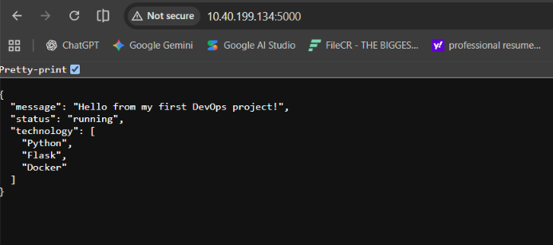
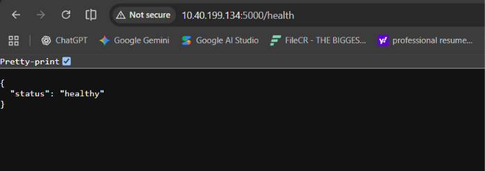
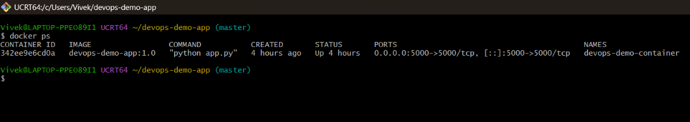

# DevOps Demo App — Flask & Docker

A simple Python Flask application packaged and run using Docker. This project demonstrates basic API endpoints, Docker image creation, container execution, and application verification.

## Features

- Returns a JSON response from the home endpoint (`/`).
- Provides a health check endpoint (`/health`).
- Runs inside a Docker container.
- Maps host port `5000` to container port `5000`.

## Technologies Used

- **Python 3.13** — application runtime.
- **Flask** — web framework.
- **Docker** — builds and runs the application container.
- **Git** — tracks project changes.

## Project Structure

```text
devops-demo-app/
├── screenshots/
│   ├── app-output.png
│   ├── health-check.png
│   └── docker-container.png
├── .dockerignore
├── .gitignore
├── Dockerfile
├── README.md
├── app.py
└── requirements.txt
```

## Application Endpoints

### 1. Home Endpoint

**URL:** `http://localhost:5000/`

The home endpoint returns a JSON response containing a welcome message, application status, and technologies used.



### 2. Health Check Endpoint

**URL:** `http://localhost:5000/health`

The health endpoint returns HTTP `200 OK` with the following JSON response when the handler executes successfully:

```json
{
  "status": "healthy"
}
```



## Run the Application with Docker

### Step 1: Prerequisites

- Docker Desktop installed and running.
- Git installed if you want to clone the repository.

### Step 2: Build the Docker Image

Run this command from the project directory:

```bash
docker build -t devops-demo-app:1.0 .
```

### Step 3: Start the Container

```bash
docker run -d --name devops-demo-container -p 5000:5000 devops-demo-app:1.0
```

This command runs the container in the background and maps host port `5000` to container port `5000`.

### Step 4: Verify the Container

```bash
docker ps
```

Confirm that `devops-demo-container` has an `Up` status and port `5000` is published.



### Step 5: Test the Application

Open these URLs in your browser:

- **Home:** http://localhost:5000/
- **Health:** http://localhost:5000/health

### Step 6: View Container Logs

```bash
docker logs devops-demo-container
```

## Main Project Files

| File | Purpose |
|---|---|
| `app.py` | Contains the Flask application and endpoints. |
| `requirements.txt` | Lists Python dependencies. |
| `Dockerfile` | Defines how the Docker image is built. |
| `.dockerignore` | Excludes unnecessary files from the Docker build context. |
| `.gitignore` | Excludes local and generated files from Git tracking. |

## What I Learned

- Creating a Flask application with JSON endpoints.
- Managing Python dependencies using `requirements.txt`.
- Building a Docker image from a Dockerfile.
- Running and inspecting Docker containers.
- Mapping container ports and testing application endpoints.
- Viewing application logs and tracking changes with Git.

## Future Improvements

- Add automated tests.
- Use a production-ready WSGI server.
- Implement a CI/CD pipeline using GitHub Actions.
- Deploy the application to a cloud platform.